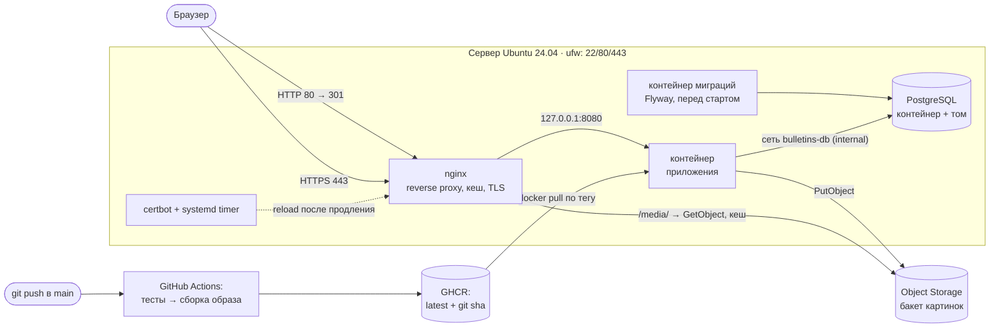

# Доска объявлений (IaC)

[](https://github.com/kicha3007-boop/devops-engineer-from-scratch-project-315/actions)
[](https://github.com/kicha3007-boop/devops-engineer-from-scratch-project-315/actions/workflows/ci.yml)

Инфраструктура и деплой приложения «Доска объявлений» (Spring Boot + React Admin): Docker-образ
и CI в GitHub Actions, сервер настраивается Ansible-плейбуком — Docker, firewall, PostgreSQL в
контейнере с миграциями, приложение, nginx с кешем статики и HTTPS от Let's Encrypt с автопродлением.
Объектное хранилище и ВМ в Yandex Cloud описаны в Terraform.

Учебный проект Хекслета: https://ru.hexlet.io/programs/devops-engineer-from-scratch

## Ссылка на приложение

> **Облачный стенд и домен не разворачивались**: у автора нет аккаунта Yandex Cloud и домена.
> Всё, что нужно для облака, описано в коде (Terraform + Ansible, раздел
> [«Деплой на ВМ в Yandex Cloud»](#деплой-на-вм-в-yandex-cloud)), но проверено только на
> локальном стенде, который повторяет сервер один в один.

- Production (после развёртывания по инструкции): `https://bulletins.example.ru` — имя задаётся
  переменной `app_domain` в `inventories/production/group_vars/all/vars.yml`.
- Локальный стенд (`make lab-up && make lab-deploy`): **https://bulletins.127.0.0.1.nip.io:28443**
  (сертификат выпущен локальным ACME-сервером Pebble, поэтому браузер предупредит о недоверенном
  корне — см. [«Локальный стенд»](#локальный-стенд-без-облака)).

### Что проверено на локальном стенде

С нуля (`make lab-down && make lab-up`), образ — `latest` из GHCR, собранный CI: первый
`make lab-deploy` — `ok=60 changed=27 failed=0`, второй — `ok=56 changed=0 failed=0`. Вывод `make lab-check`:

```text
HTTPS и nginx
  [ok]   HTTP -> HTTPS: 301 https://bulletins.127.0.0.1.nip.io:28443/some/page?x=1
  [ok]   сертификат проверен по цепочке до корня ACME
  [ok]   главная страница: HTTP/2 200
  [ok]   заголовок HSTS
  [ok]   сертификат: issuer=CN = Pebble Intermediate CA 0103e2 notAfter=Jan 25 12:47:28 2027 GMT
  [ok]   TLS 1.1 отклонён, разрешены только TLS 1.2/1.3
  [ok]   статика /assets/index-CaNKzDti.js отдаётся из кеша nginx (X-Cache-Status: HIT)
Приложение и БД
  [ok]   объявлений в БД: 10
S3: загрузка и скачивание через приложение
  [ok]   загружен файл: key=bulletins/11006523-9176-4acd-a9a0-66dfef11f87f.png
  [ok]   ссылка на файл: https://bulletins.127.0.0.1.nip.io:28443/media/bulletins/11006523-...png
  [ok]   скачанный через nginx файл совпадает с загруженным
  [ok]   картинка отдаётся из кеша nginx (HIT)
  [ok]   объявление #11 с картинкой из S3 сохранено
Сеть: наружу открыты только 22/80/443
  [ok]   порт 5432 снаружи закрыт
  [ok]   порт 8080 снаружи закрыт
  [ok]   порт 9090 снаружи закрыт
  [ok]   ufw: Status: active
Продление сертификата
  [ok]   certbot.timer включён: Wed 2026-10-28 11:13:41
  [ok]   после продления nginx отдаёт новый сертификат (хук reload): serial=6A6E4BE0CDED5C3C -> serial=07F9911F4DF62E77
Все проверки пройдены
```

После `make lab-reboot` контейнеры БД и приложения поднялись сами (~20 с до `healthy`),
объявление #11 на месте, повторный `make lab-deploy` — `changed=0`. Также проверены: `terraform validate` — `Success! The configuration is valid.`,
`ansible-lint` — `Passed: 0 failure(s), 0 warning(s)` (профиль `production`), проверка из образа
Хекслета (`ansible-playbook --check` по localhost) — `All tests passed`.

## Что внутри



| Шаг задания | Где сделано |
|---|---|
| 1. Форк, Dockerfile, Makefile | код приложения перенесён из [Hexlet-components/project-devops-deploy](https://github.com/Hexlet-components/project-devops-deploy) (коммит `32620fc`); [`Dockerfile`](Dockerfile) — многоступенчатый: Node → JDK + Gradle → JRE |
| 2. GitHub Actions | [`.github/workflows/ci.yml`](.github/workflows/ci.yml): тесты и линтеры → образ → GHCR с тегами `latest` и `<git sha>`, публикация только из `main` |
| 3. Сервер и Docker через Ansible | [`playbook.yml`](playbook.yml), роли `common`, [`geerlingguy.docker`](requirements.yml), `docker_access` (пользователь `deploy` в группе `docker`), `firewall` (ufw: 22/80/443) |
| 4. Деплой приложения | роль `app`: образ из реестра по тегу, env-файл из шаблона, каталог логов, `restart_policy: unless-stopped` |
| 5. Домен и DNS | раздел [«Домен и DNS»](#домен-и-dns), `terraform/dns.tf` (если домен делегирован в Yandex Cloud) |
| 6. БД и миграции | роль `postgres` (контейнер во внутренней сети без проброса порта, том с данными); миграции Flyway — отдельный одноразовый контейнер перед стартом приложения |
| 7. S3 | `terraform/storage.tf` (бакет, сервисные аккаунты, ключи, политика); на стенде — MinIO и [`lab/s3.yml`](lab/s3.yml) |
| 8. Nginx | роль `nginx`: reverse proxy, кеш собранного фронтенда (`/assets/`) и картинок из S3 (`/media/`) |
| 9. HTTPS | роль `certbot`: сертификат Let's Encrypt (HTTP-01 через webroot), `certbot.timer`, хук `systemctl reload nginx`, редирект HTTP → HTTPS, только TLS 1.2/1.3 и AEAD-шифры, HSTS |

### Изменения в приложении относительно исходного репозитория

- Добавлены миграции Flyway (`src/main/resources/db/migration`): в профиле `prod` схема меняется только
  ими, Hibernate лишь сверяет её (`ddl-auto: validate`). В `dev` (H2) всё как было.
- Заполнение демо-данными можно отключить (`APP_SEED_ENABLED=false`) — так запускается контейнер миграций.
- В профиле `prod` логи дублируются в файл с ротацией `/app/logs` (на сервере — `/opt/bulletins/logs`).
- Убраны конфиги инструментов CI исходного репозитория (mise, hk, commitlint, lychee) и его workflow.

## Требования

**Машина, с которой запускается деплой** — только Docker (Docker Desktop на Windows/macOS или Docker
Engine на Linux), `make` и `git`. Ansible, ansible-lint, Terraform и клиент S3 работают в контейнере
`toolbox` ([`lab/toolbox/Dockerfile`](lab/toolbox/Dockerfile)), который собирается командой `make toolbox`.
Если Ansible ≥ 2.18 и Terraform ≥ 1.6 установлены локально, можно обойтись без контейнера: `make deploy TOOLBOX=`.

**Целевой сервер** — Ubuntu 24.04 LTS (x86_64), от 2 vCPU и 2 ГБ RAM, 20 ГБ диска; доступ по SSH по ключу
пользователем с `sudo` без пароля; открыты входящие 22, 80, 443; выход в интернет (GHCR, Docker Hub,
apt, Let's Encrypt, Object Storage). Домен с A-записью на публичный IP сервера.

## Локальный стенд (без облака)

Стенд повторяет production: «ВМ» — контейнер `p315-vm` с чистой Ubuntu 24.04, systemd и sshd;
плейбук ставит на неё Docker, ufw, nginx, certbot и приложение ровно так же, как на настоящий сервер.
Облачные сервисы заменены локальными: Object Storage → MinIO (`p315-minio`), Let's Encrypt → Pebble
(`p315-pebble`, тестовый ACME-сервер от авторов Let's Encrypt), домен → `bulletins.127.0.0.1.nip.io`
(публичный DNS nip.io отдаёт 127.0.0.1, внутри стенда это имя ведёт на «ВМ»). Отличаются только
значения в `inventories/lab/group_vars/all/vars.yml`.

```bash
make lab-up       # образы стенда, секреты (vault), «ВМ» + MinIO + Pebble, роли из requirements.yml, бакет
make lab-deploy   # playbook.yml на «ВМ», образ из GHCR (повторный запуск: changed=0)
make lab-check    # HTTPS, редирект, шифры, кеш nginx, БД, загрузка файла в S3, продление сертификата
```

Открыть в браузере: https://bulletins.127.0.0.1.nip.io:28443 (HTTP: http://bulletins.127.0.0.1.nip.io:28080
перенаправит на HTTPS). Предупреждение о сертификате ожидаемо: его выпустил Pebble. Корень Pebble
можно скачать командой `docker exec p315-pebble wget -qO- --no-check-certificate https://localhost:15000/roots/0`
и при желании добавить в доверенные. Если nip.io не резолвится (нет интернета), добавьте в `hosts`
строку `127.0.0.1 bulletins.127.0.0.1.nip.io`. Если в системе настроен HTTP-прокси, добавьте
`.nip.io` в исключения (`NO_PROXY`), иначе запросы к стенду уйдут в прокси (`curl --noproxy '*' ...`).

Порты на хосте (только 127.0.0.1): 28080 → 80, 28443 → 443, 28022 → 22 «ВМ», 28901 — консоль MinIO
(логин и пароль — в `lab/minio.env`).

Другие команды стенда:

```bash
make lab-deploy TAGS=app            # только приложение (PostgreSQL, миграции, контейнер)
make lab-image                      # собрать образ из текущего кода и выкатить на стенд без реестра
make lab-reboot                     # перезагрузить «ВМ»: всё поднимется само
make lab-ssh                        # зайти на «ВМ»
make lab-down                       # удалить стенд вместе с томами
```

Как стенд отличается от облака — честно:

- «ВМ» — привилегированный контейнер (нужен для systemd, Docker внутри и iptables). ufw в нём
  работает по-настоящему, но порты на хост пробрасывает внешний Docker Desktop.
- Сертификат выпускает Pebble, а не Let's Encrypt: протокол ACME, certbot, проверка HTTP-01,
  таймер и хук продления — те же, отличается только адрес сервера (`certbot_acme_server`) и то, что
  «ВМ» доверяет корню Pebble (вшит в образ `lab/vm`, как корни Let's Encrypt в обычной Ubuntu).
- Бакет и ключи в MinIO создаёт `lab/s3.yml`, в облаке — Terraform.
- Образы Docker Hub «ВМ» тянет через зеркало `mirror.gcr.io` (Docker Hub из РФ часто недоступен).

## Деплой на ВМ в Yandex Cloud

Не выполнялся (нет облачного аккаунта), `terraform validate` и `ansible-lint` проходят в CI.

1. **Инструменты.** `make setup` — собрать toolbox и поставить роли/коллекции из `requirements.yml`.
2. **Облако (Terraform).** Создать каталог в Yandex Cloud и OAuth/IAM-токен, затем:

    ```bash
    cp terraform/terraform.tfvars.example terraform/terraform.tfvars   # folder_id, ssh_public_key
    export YC_TOKEN=... YC_CLOUD_ID=...
    make tf-init tf-plan tf-apply        # ВМ, сеть, группа безопасности, бакет, сервисные аккаунты
    make tf-output                       # vm_public_ip, bucket_name, app_access_key
    docker compose -f lab/compose.yaml run --rm toolbox terraform -chdir=terraform output -raw app_secret_key
    ```

    `YC_TOKEN` и `YC_CLOUD_ID` из окружения передаются в toolbox автоматически. Провайдер скачивается
    через зеркало `terraform-mirror.yandexcloud.net` (`lab/toolbox/terraformrc`). Состояние Terraform
    хранится локально в `terraform/terraform.tfstate` (в `.gitignore`).
3. **Домен** — см. [«Домен и DNS»](#домен-и-dns). Имя прописать в `app_domain`
   (`inventories/production/group_vars/all/vars.yml`), имя бакета — в `app_s3_bucket`.
4. **Секреты (Ansible Vault).**

    ```bash
    echo 'длинный-пароль' > .vault_pass                  # в git не попадает
    cp inventories/vault.yml.example inventories/production/group_vars/all/vault.yml
    # заполнить: IP из vm_public_ip, пароль БД, ключи S3 из terraform output, e-mail для Let's Encrypt
    make vault-encrypt                                    # править потом: make vault-edit
    ```

    Зашифрованный `vault.yml` в репозитории содержит заглушки — замените его своим.
5. **Деплой.** `make deploy SSH_KEYS_DIR=~/.ssh` (ключ из `ssh_public_key`). Повторный запуск ничего
   не меняет; обновление до свежей сборки — тот же `make deploy`, только приложение — `make deploy TAGS=app`.
6. **Откат** — деплой предыдущей сборки по её тегу (полный git sha коммита в `main`):
   `make deploy TAGS=app TAG=<sha>`. Миграции Flyway только добавляются, поэтому старая версия
   работает с новой схемой, пока миграции обратно совместимы.

Если пакет в GHCR приватный, задайте `vault_app_registry_username` и `vault_app_registry_password`
(токен GitHub с правом `read:packages`) — роль выполнит `docker login`.

## Домен и DNS

1. Получить домен: купить у регистратора или взять бесплатный третьего уровня
   ([FreeDNS](https://freedns.afraid.org/), [No-IP](https://www.noip.com/)).
2. Создать A-запись `bulletins.<домен>` → публичный IP сервера (`make tf-output` → `vm_public_ip`).
   Если домен делегирован на `ns1.yandexcloud.net`/`ns2.yandexcloud.net`, запись создаст Terraform:
   `dns_zone = "<домен>"` в `terraform.tfvars`.
3. Проверить распространение (обычно минуты, иногда до суток):

    ```bash
    dig +short bulletins.example.ru A           # должен вернуть IP сервера
    dig +short bulletins.example.ru A @8.8.8.8  # то же через публичный резолвер
    nslookup bulletins.example.ru
    ```

4. Только после этого `make deploy`: certbot проверяет домен по HTTP на порту 80.

## Docker-образ

```bash
make docker-build                  # образ ghcr.io/kicha3007-boop/devops-engineer-from-scratch-project-315:local
make docker-test                   # тесты приложения внутри сборки (стадия test)
make docker-start                  # http://localhost:28081 — профиль dev, H2 в памяти

# Production-профиль: PostgreSQL и S3 из переменных окружения
docker run --rm -p 8080:8080 \
  -e SPRING_DATASOURCE_URL=jdbc:postgresql://db:5432/bulletins \
  -e SPRING_DATASOURCE_USERNAME=bulletins -e SPRING_DATASOURCE_PASSWORD=... \
  -e STORAGE_S3_BUCKET=... -e STORAGE_S3_REGION=ru-central1 \
  -e STORAGE_S3_ENDPOINT=https://storage.yandexcloud.net \
  -e STORAGE_S3_ACCESSKEY=... -e STORAGE_S3_SECRETKEY=... \
  ghcr.io/kicha3007-boop/devops-engineer-from-scratch-project-315:latest
```

Реестр — GitHub Container Registry: `ghcr.io/kicha3007-boop/devops-engineer-from-scratch-project-315`,
теги `latest` (последняя сборка `main`) и полный git sha коммита. Публикует workflow `CI` токеном
`GITHUB_TOKEN` (`permissions: packages: write`), отдельных секретов не нужно.

Приложение без Docker (нужен JDK 27): `make test`, `make lint`, `make run`, `make build`.

## Секреты

- Пароль БД, ключи S3, адрес и пользователь сервера — в `inventories/<окружение>/group_vars/all/vault.yml`,
  зашифрованном Ansible Vault; в `vars.yml` рядом — только ссылки вида `{{ vault_postgres_password }}`.
- Пароль Vault — в `.vault_pass` (в `.gitignore`). Секреты локального стенда генерирует `make lab-secrets`,
  в git они не попадают.
- На сервере переменные окружения приложения раскладываются шаблоном в `/opt/bulletins/app.env`
  (права `0600`), в задачах с секретами включён `no_log`.
- В инвентаре нет адресов и пользователей: `ansible_host`/`ansible_user` берутся из Vault.

## Команды Makefile

| Команда | Что делает |
|---|---|
| `make setup` | собрать toolbox и поставить роли/коллекции из `requirements.yml` (`make install`) |
| `make deploy` | подготовка сервера и деплой (`ENV=production` по умолчанию, `TAGS=`, `TAG=`) |
| `make deploy-check` | сухой прогон с `--check --diff` |
| `make vault-encrypt` / `vault-edit` / `vault-view` | работа с секретами |
| `make tf-init` / `tf-validate` / `tf-plan` / `tf-apply` / `tf-output` / `tf-destroy` | Terraform |
| `make lint-infra` | `ansible-lint` и `terraform fmt -check` |
| `make lab-up` / `lab-deploy` / `lab-check` / `lab-down` | локальный стенд |
| `make docker-build` / `docker-test` / `docker-start` | образ приложения |
| `make test` / `lint` / `run` / `build` | приложение через Gradle |

---

<details>
<summary>Автоматические тесты Хекслета</summary>

Тесты запускаются на каждый коммит. За запуск отвечает файл `.github/workflows/hexlet-check.yml` — не удаляйте и не переименовывайте ни его, ни репозиторий.

</details>

## О Хекслете

[Хекслет](https://ru.hexlet.io/) — школа программирования: авторские программы обучения с практикой, поддержкой наставников и реальными проектами, которые остаются в резюме. Этот репозиторий — один из таких проектов.
